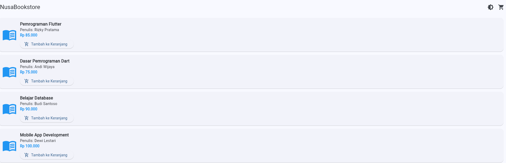
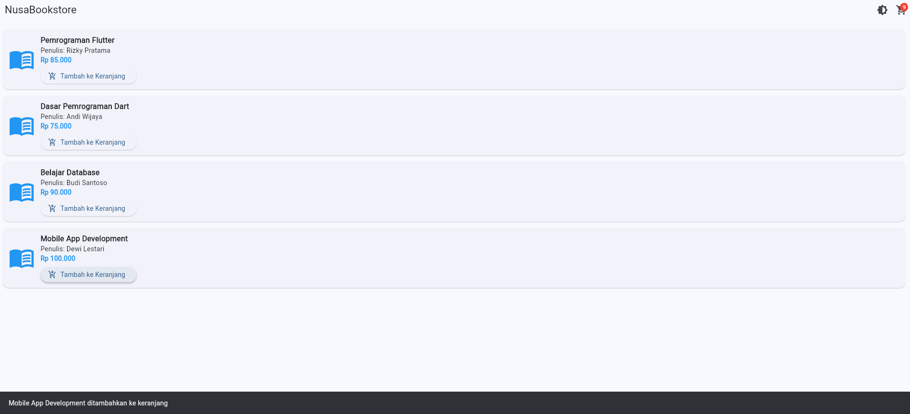
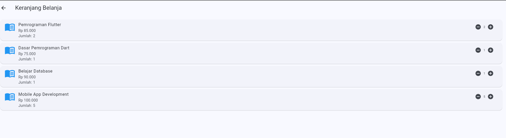
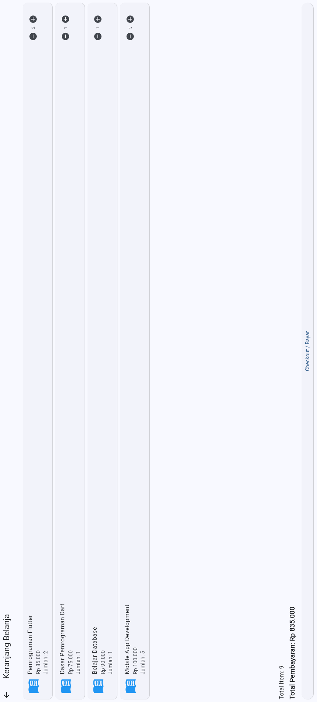
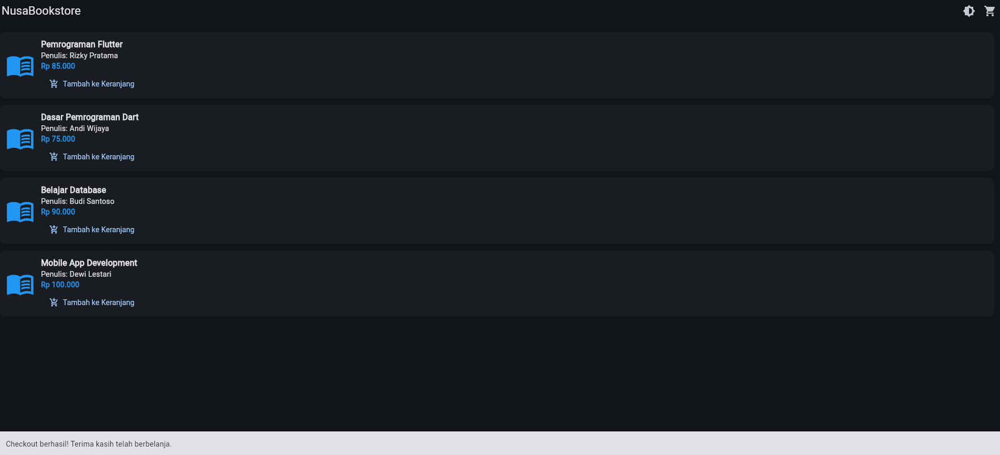

# NusaBookstore - Sesi 04

**Nama:** Rully Aulia  
**Program Studi:** Informatika  
**Universitas:** Universitas Nusa Putra

## Deskripsi
Aplikasi toko buku sederhana berbasis Flutter dengan State Management Provider.

## Fitur Aplikasi
1. Katalog buku
2. Tambah buku ke keranjang
3. Badge jumlah item
4. Perhitungan total pembayaran
5. Light Mode dan Dark Mode
6. Checkout dengan notifikasi SnackBar

## Teknologi
- Flutter
- Dart
- Provider

## Screenshot Aplikasi

